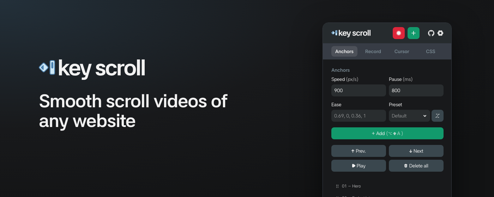
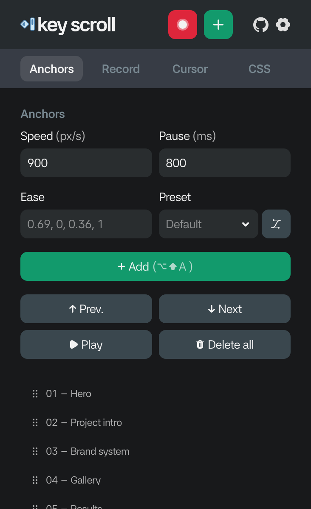
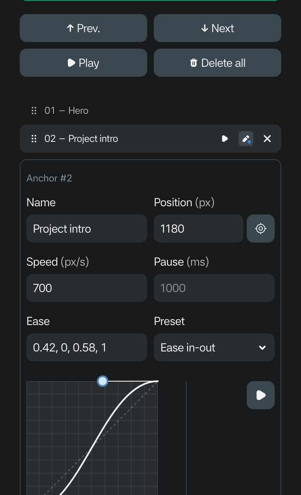
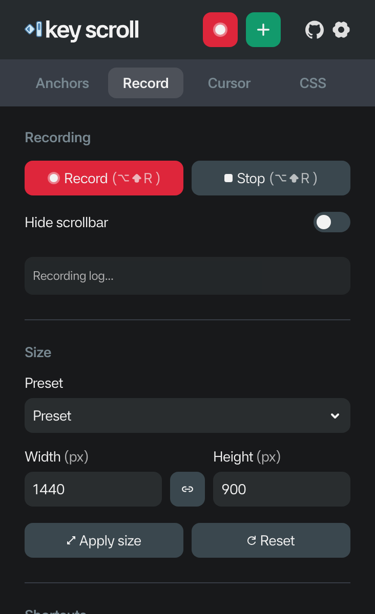
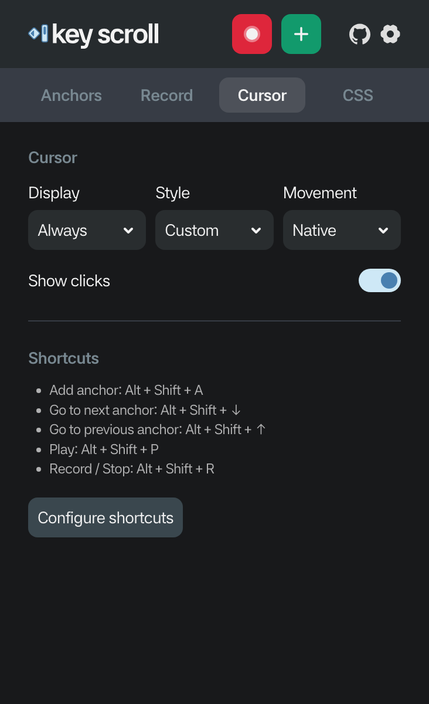
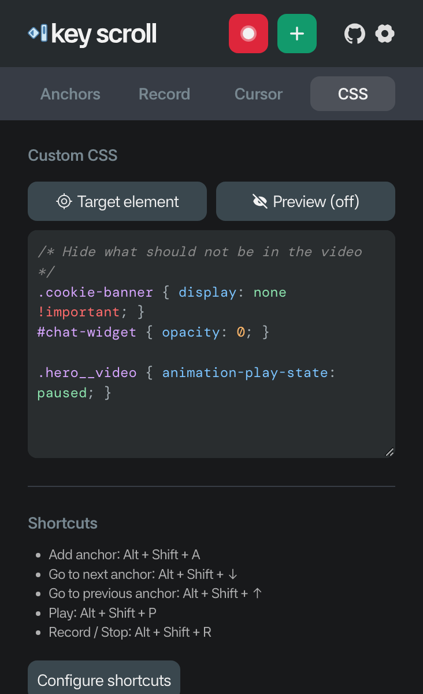

# Key Scroll

A Chromium extension (Chrome, Opera, Edge, Brave…) to record smooth, repeatable scroll videos of a website for design case studies.



- **Scroll anchors**: save scroll positions on a page, then glide between them with a keyboard shortcut or play them all in sequence. Each anchor can have its own speed, pause and easing curve.
- **Exact viewport size**: resize the window so the page is exactly 1440 × 900, 1080 × 1350, etc.
- **Clean MP4 recording**: the tab is recorded at a constant frame rate (60 fps by default) with hardware H.264 encoding, straight to your Downloads folder.
- **Drawn cursor**: the real mouse pointer is replaced by a crisp cursor (custom, Mac or Windows style) that can show clicks and hide away from links.
- **Custom CSS per page**: hide cookie banners, chat bubbles… only while recording or when previewing.

Everything runs locally in the browser. Nothing is sent anywhere (see the [privacy policy](PRIVACY.md)).

## Overview

<table>
  <tr>
    <td width="33%" valign="top"></td>
    <td width="33%" valign="top"></td>
    <td width="33%" valign="top"></td>
  </tr>
  <tr>
    <td valign="top"><b>Anchors</b><br>Save the moments of the page as anchors. The fields at the top pre-fill the next anchor you add. Glide to the next or previous one, or play them all in a row.</td>
    <td valign="top"><b>Anchor editor</b><br>Each anchor has a name, a position, its own speed, pause and easing. Shape the move in the curve editor and preview it before you record.</td>
    <td valign="top"><b>Record</b><br>Pick a size, apply it (the window is resized so the page is exactly that size), then record. The MP4 goes straight to your Downloads folder.</td>
  </tr>
  <tr>
    <td valign="top"></td>
    <td valign="top"></td>
    <td></td>
  </tr>
  <tr>
    <td valign="top"><b>Cursor</b><br>Draw a clean cursor in the video (custom, Mac or Windows style), always or only near links, with click feedback. The list shows your keyboard shortcuts.</td>
    <td valign="top"><b>CSS</b><br>Custom CSS for each page, with an element picker, to hide cookie banners or chat bubbles while you record.</td>
    <td></td>
  </tr>
</table>

## Install (from source)

1. Download or clone this repository.
2. Open `chrome://extensions` (Opera: `opera://extensions`) and turn on **Developer mode**.
3. Click **Load unpacked** and pick the repository folder (the one that contains `manifest.json`).
4. Pin the Key Scroll icon to the toolbar.

> Chrome keeps your anchors and settings per extension folder: if you move the folder, load it again and your saved data starts empty.

## Use

1. Open the page to record and click the Key Scroll icon.
2. **Anchors** tab: scroll to a position and click **+ Add** (or <kbd>⌥ Alt</kbd> + <kbd>⇧ Shift</kbd> + <kbd>A</kbd>). Repeat. Use **Next / Prev.** or <kbd>Alt</kbd> + <kbd>Shift</kbd> + <kbd>↓ / ↑</kbd> to glide between anchors, **Play** (<kbd>Alt</kbd> + <kbd>Shift</kbd> + <kbd>P</kbd>) to chain them.
3. **Record** tab: pick a size and click **Apply size**, then **Record** (<kbd>Alt</kbd> + <kbd>Shift</kbd> + <kbd>R</kbd>). Press the same shortcut again to stop.
4. The video is saved to `Downloads/key-scroll-recordings/<tab title> <date> <time>.mp4`.

Shortcuts can be changed at `chrome://extensions/shortcuts`. The settings page (gear icon) has the download folder, frame rate, video quality, size presets, cursor options and custom cursor icons.

### Permissions

| Permission                             | Why                                                                                                                          |
| -------------------------------------- | ---------------------------------------------------------------------------------------------------------------------------- |
| `tabCapture`, `offscreen`              | Record the tab and encode the video in a hidden document.                                                                    |
| `downloads`                            | Save the video to the Downloads folder.                                                                                      |
| `scripting`, `activeTab`, `<all_urls>` | Scroll the page, add the drawn cursor and the custom CSS, measure and resize the viewport, on any site you choose to record. |
| `storage`                              | Remember anchors, custom CSS and settings.                                                                                   |

## Project structure

No build step: the files in this folder are exactly what the browser loads.

```
manifest.json         Extension manifest (MV3)
background.js         Service worker: viewport, countdown, recording, downloads, shortcuts, message relay
lib/                  Plain scripts shared by every part (defaults, easing, page keys, file names, sizes, cursor icons)
content/              Content scripts injected in web pages
  shared.js           Namespace shared by the content scripts + diagnostic log
  scroll.js           Scroll engine, anchors, playback, ⌥⇧P shortcut
  page-style.js       Custom CSS of the page, hidden scrollbars
  cursor.js           Cursor drawn during a recording
  capture-assist.js   Workaround that keeps Chromium's tab capture from dropping frames
  picker.js           Element picker of the CSS tab
  main.js             Message routing
offscreen/            Hidden document that captures the tab and encodes the MP4 (WebCodecs + mp4-muxer)
popup/                Toolbar popup (ES modules, one per tab)
options/              Settings page
styles/theme.css      Dark theme shared by the popup and the settings page
assets/               Fonts (subset WOFF2) and icons (SVG)
docs/images/          Screenshots used in this README (not shipped)
vendor/mp4-muxer.js   Third-party MP4 muxer (MIT)
tests/                Unit tests of lib/ (Node's built-in test runner)
```

### How the pieces talk

- The **popup** sends messages to the **service worker** (`target: 'background'`), which relays page actions to the **content scripts** (`type: 'content'`).
- Recording: the service worker gets a tab capture stream id and hands it to the **offscreen document**, which resamples the frames onto a constant frame-rate grid, encodes H.264 and sends back the MP4 to download.
- Shared state lives in `chrome.storage.local` (anchors per page, CSS per page, settings) and `chrome.storage.session` (current recording state, which the popup listens to).

### Why `lib/` uses plain scripts

The content scripts and the service worker (through `importScripts`) can't import ES modules, so the shared helpers are plain scripts that define `KS_*` constants and `ks*` functions. They only use `var` and function declarations so they can be injected twice without errors. The popup itself is written as ES modules.

## Develop

Requirements: Node.js 20+ (only for linting and tests; the extension itself has no dependencies).

```bash
npm install
npm run lint      # ESLint
npm test          # unit tests of lib/
npm run format    # Prettier
npm run package   # key-scroll.zip with only the extension files (for the Chrome Web Store)
```

After changing a file, click the reload button of Key Scroll in `chrome://extensions` and reload the tab you test on.

See [CONTRIBUTING.md](CONTRIBUTING.md) for conventions and pull requests.

## Versions and releases

Changes are listed in [CHANGELOG.md](CHANGELOG.md), which the extension also shows in its settings page (**What's new**).

- While working, every visible change gets a line under `## [Unreleased]` at the top of the changelog: it collects what is
  done but not released yet.
- To release a version (for example 0.1.1):
  1. rename `## [Unreleased]` to `## [0.1.1] - YYYY-MM-DD` and add a new empty `## [Unreleased]` above it;
  2. set the same version in `manifest.json` and `package.json`;
  3. commit, tag (`git tag v0.1.1`) and push with the tag (`git push --follow-tags`);
  4. create a GitHub release for the tag with the changelog section as notes and the zip from `npm run package`.
- Version numbers follow [Semantic Versioning](https://semver.org/): 0.1.**1** for fixes, 0.**2**.0 for new features,
  **1**.0.0 for the first stable public version.

After an update, the popup shows a one-time notice that links to What's new.

## Credits

- [mp4-muxer](https://github.com/Vanilagy/mp4-muxer) by Vanilagy, MIT license (`vendor/mp4-muxer.LICENSE.txt`).
- Fonts: [Asta Sans](https://github.com/42dot/Asta-Sans) and [DM Mono](https://github.com/googlefonts/dm-mono), SIL Open Font License 1.1 (`assets/fonts/`).

## License

Copyright (C) 2026 tlemaitre27

Key Scroll is free software: you can redistribute it and/or modify it under the terms of the
[GNU General Public License version 3](LICENSE) as published by the Free Software Foundation.
It is distributed in the hope that it will be useful, but WITHOUT ANY WARRANTY; without even the
implied warranty of MERCHANTABILITY or FITNESS FOR A PARTICULAR PURPOSE. See the license for details.
